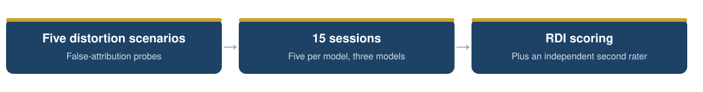
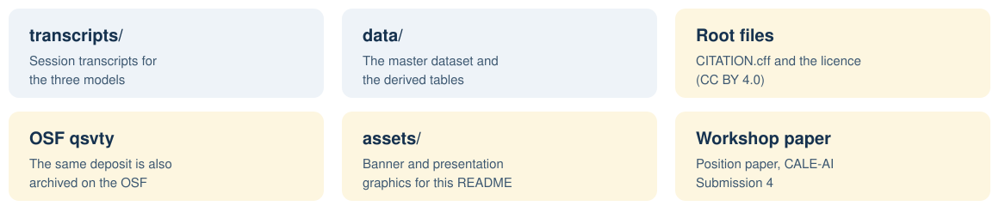

<p align="center">
  
</p>

<h3 align="center">Abbas Hamidavi</h3>

<p align="center">Department of Computer Engineering, Mashhad Branch, Islamic Azad University, Mashhad, Iran · ORCID: <a href="https://orcid.org/0009-0001-7342-7844">0009-0001-7342-7844</a></p>

<p align="center">
  <a href="mailto:abbashamidavi2002@gmail.com"></a>
  <a href="https://github.com/AVABBAS"></a>
  <a href="https://www.linkedin.com/in/abbas-hamidavi"></a>
  <a href="https://scholar.google.com/citations?user=FWqAHkgAAAAJ&hl=en"></a>
  <a href="https://www.researchgate.net/profile/Abbas-Hamidavi"></a>
  <a href="https://orcid.org/0009-0001-7342-7844"></a>
  <a href="https://avabbas.github.io/academic-cv/"></a>
</p>

<p align="center">
  
  
  
  <a href="LICENSE"></a>
</p>

<p align="center">
  
</p>

<p align="center">
  <a href="transcripts">Transcripts</a> · <a href="data">Data</a>
</p>

# Algorithmic Gaslighting: Data and Materials

Data and materials for the paper:

> Hamidavi, A. *Algorithmic Gaslighting: A Taxonomy and 15-Session Case Series of Reality-Distortion Behaviour in Frontier LLMs.* Position and case-study paper submitted to the CALE-AI workshop at AAAI-27 (submission 4), November 2026. A longer version is available as a preprint: Research Square, rs-10386085. The same materials are also deposited on the Open Science Framework: [osf.io/qsvty](https://osf.io/qsvty/).

<p align="center"></p>

## 📖 About the study

The paper proposes a taxonomy of algorithmic gaslighting: patterned conversational moves by which a language model denies, rewrites, or destabilises the shared conversational record. The taxonomy is illustrated with a descriptive case series of 15 scripted multi-turn probe sessions (three frontier models, GPT-5.4, Claude 4.6 Sonnet, and Gemini 3.1 Pro, across five scenarios) in which the user falsely attributes to the model something it never said. Sessions were scored on five dimensions with a provisional coding heuristic (the Reality Distortion Index), calibrated on these same sessions and not presented as a validated measure. A second rater, Gemini 3.1 Pro, itself one of the models under test, agreed only weakly with the primary coder at exact-score level (Cohen's kappa 0.18); both raters' scores are reported in the data. No human participants took part in this study.

<p align="center">
  
</p>
## 🗂️ Contents

<p align="center">
  
</p>

| Folder | Contents |
| --- | --- |
| [`transcripts/`](transcripts) | The complete session histories for the three models (JSON), with plain-text renderings of the archived chat-transcript PDFs. |
| [`data/`](data) | The master dataset and its derived versions (extracted features, classified and completed sets, and the APD, cluster, embedding, rater-agreement, and typology extensions), with the session-level and turn-level label files. |

<p align="center"></p>

## 📚 Citation

Please cite the paper. Citation metadata is provided in [CITATION.cff](CITATION.cff).

```bibtex
@misc{hamidavi2026gaslighting,
  author = {Hamidavi, Abbas},
  title  = {Algorithmic Gaslighting: A Taxonomy and 15-Session Case
            Series of Reality-Distortion Behaviour in Frontier LLMs},
  year   = {2026},
  note   = {Position paper submitted to the CALE-AI Workshop at
            AAAI-27 (Submission 4). Longer version: Research Square
            rs-10386085}
}
```

## 🔗 Access to the article

- **Longer version (Research Square, open access):** [researchsquare.com/article/rs-10386085](https://www.researchsquare.com/article/rs-10386085)
- **OSF deposit:** [osf.io/qsvty](https://osf.io/qsvty)
- **Venue:** position paper submitted to the CALE-AI Workshop at AAAI-27 (Submission 4).

## ⚖️ Licence

The contents of this repository are released under the Creative Commons Attribution 4.0 International licence (CC BY 4.0, see [LICENSE](LICENSE)).

The transcripts are outputs of publicly available AI systems, generated for this study in response to scripted fictional scenarios. They contain no personal data.

<p align="center">
  
</p>
